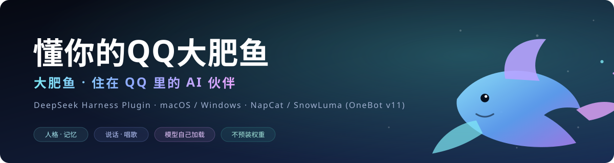

<div align="center">



**懂你的QQ大肥鱼 ("The QQ Big Fish That Knows You") — an AI companion living inside QQ · A DeepSeek Harness plugin**

A persona, a mood, and a memory of her own. She chats, sees images, sends voice notes, collects stickers, sings in her own voice, writes Qzone diaries, browses Bilibili — and sometimes reaches out to you first.

**English** · [简体中文](README.md)

[](LICENSE)
[](https://github.com/deepseek-ai/deepseek-harness)
[](https://github.com/SnowLuma/SnowLuma)
[](#-contributing)

</div>

> QQ Soul turns the AI inside **DeepSeek Harness (DSH)** into someone with a QQ account: her own persona, moods, a long-term memory of your chats, and a personality that shows in every reply. She can follow group conversations, send voice notes, sing with her own voice, keep a Qzone diary, and browse Bilibili.
>
> This is not another keyword-reply bot: every reply, every decision to join a conversation, every model choice, and every outgoing message is a pluggable module. Everything is off by default — **not a single message reaches QQ until you turn it on.**

```
QQ ⇄ NapCat / SnowLuma (OneBot v11, installed by you) ⇄ this plugin ⇄ DSH sessions
                                                       ├─ persona + mood + memory
                                                       ├─ tools / hot-reloadable modules
                                                       └─ web panel (DSH Web)
```

---

## ✨ Why QQ Soul

<table>
  <tr>
    <td width="25%" valign="top"><h3>🫧 Chats like a person</h3>In groups she waits for a pause and reads the whole stretch before replying; she always answers when called, joins by topic otherwise, can quote, use stickers, send voice — or stay quiet.</td>
    <td width="25%" valign="top"><h3>🧩 Everything is a module</h3>Even “should she reply in this group”, the prompt, message splitting, outgoing content and model selection are hookable. Install community modules from the panel; upgrades never overwrite yours.</td>
    <td width="25%" valign="top"><h3>🧠 Long-term memory</h3>A local memory store: things she noted, daily consolidated facts, per-person profiles, relationship insights and speaking style — recalled by relevance, time and a forgetting curve.</td>
    <td width="25%" valign="top"><h3>🛡️ Safe by default</h3>Master switch off, dry run on; group / non-owner chats get no local tools; sensitive actions require the whole turn to be the owner.</td>
  </tr>
</table>

## 🎭 What she can do

| | Capability | Details |
|---|---|---|
| 💬 | **DM & group chat** | Each QQ DM/group maps to its own DSH session — watch her reasoning and tool calls, or jump in |
| 🎨 | **Persona & mood** | Switchable persona cards edited section by section; mood driven by praise/anger, affecting tone, stickers, voice and reply speed |
| 🗣️ | **Voice notes & singing** | edge-tts, local CosyVoice / GPT-SoVITS, or any HTTP TTS; import RVC voices for covers so she talks and sings with the same voice |
| 😀 | **Stickers** | Auto-collect, AI naming/tagging, context-aware sticker choice; marketplace stickers sent as-is |
| 📖 | **Qzone** | Writes diaries from the day’s chats, replies to comments as her persona, browses friends’ feeds |
| 📺 | **Bilibili** | Picks videos from interests and memory, reads info/subtitles/comments, comments, shares to your DM; follows up on replies to her comments |
| 🖼️ | **Image gen & local APIs** | Built-in or your own image/TTS/cover/ASR services; the panel generates scripts that take effect instantly |
| 🧠 | **Memory** | Memory store, per-person profiles, relationship insights, speaking style and diaries go into context; import old notes; search/edit/delete and adjust automatic memory capacity in the panel (default 3,000) |
| 🐟 | **Desktop pet (optional)** | A pet module puts her on your desktop: idle actions, muttering, work-status reactions — never posts to QQ |
| 🌙 | **Proactive** | Proactive chats, a purpose engine, good-night moods — with awake hours, frequency and allow-lists |
| 🧩 | **Module market** | One-click community modules (pet, Douyin, Heybox, group admin, phone automation, …), configs and logins kept |
| 🔐 | **Permission page** | Every sensitive action is 关 / owner-DM only / everyone, re-checked at execution; dry run never performs side effects |

> Deeper module, command and API docs live in [the user manual (Chinese)](docs/USER-MANUAL.md).

## 🚀 Quick start

**3 minutes to talk to her in QQ.** You need: a computer, a spare QQ account, and a gateway that keeps the bot account online.

> Prefer a guided page? Open [`docs/install.html`](docs/install.html) in a browser; it shows only the steps for your OS.
> Want the long version? See [`docs/quickstart.md`](docs/quickstart.md) (Chinese).

### Three required steps

**① Install the plugin**

In DSH choose **"install from a local directory"** and point it at this folder — **not** a GitHub URL. Restart DSH and **QQ Soul** appears in the sidebar.

CLI equivalent:

```bash
dsh plugin --profile <profile> add "<plugin directory>"
```

**② Put the bot account online**

| OS | Gateway | How |
|---|---|---|
| **macOS** | NapCat | Install into QQ → open `http://127.0.0.1:6099` and scan the bot account → enable **forward WebSocket** (recommended port `6700`) → back in the panel, **Connection → Start QQ & gateway** |
| **Windows** | SnowLuma full / NapCat | NapCat already installed? Use it. Otherwise download [SnowLuma](https://github.com/SnowLuma/SnowLuma/releases) full (not lite), extract to an ASCII-only path, accept the EULA yourself, log in the bot account, then click **Start QQ & gateway** |

> SnowLuma is Windows-only; on macOS the panel preselects NapCat. LLOneBot, Lagrange and any OneBot v11 implementation also work.

**③ Dry run**

Leave **Dry run** on, message the bot from your main account, and check **Overview → Logs** to see what she thought. Turn dry run off when it looks right.

> ⚠️ Do **not** install the upstream Aurabot plugin alongside this one — same mount ID and data directory, which causes duplicate replies.

### Optional extras (chat works without them)

- **Voice notes / local voices**: panel **Overview → Audio service → Start**, then enable it and preview a line on the **Voice** page. Online edge-tts is the default and needs zero downloads.
- **Covers / singing with her voice** (macOS ~5 GB, Windows ~8 GB): panel **Song → One-click install**, then import a `.pth` voice model you have rights to use. Pick the install location with the buttons — never type paths by hand.
- **Desktop pet / image generation**: install from their own panel pages; they do not affect QQ chat.

### Self-check

Panel **Install center** shows five lights: **plugin / QQ gateway / audio service / voice / covers**. The first two must be green; the rest track optional features. The detailed **Connection check** runs `service / deps / gateway / tts / song`; copy any red step's error to an AI.

### Upgrade

Run the local-directory install again and restart DSH. Settings, persona and memory are preserved.

### Audio service & covers (implementation notes)

Voice and singing are served by the bundled `services/` package: **single port `127.0.0.1:9876`, zero third-party deps, off by default, no bundled models**. See [docs/SERVICE.md](docs/SERVICE.md) (Chinese) for endpoints, installers, self-check and backend selection.

## 🧩 Module system

Apart from the core (config, QQ gateway, chat hub, persona, permissions, panel), **every feature is a module**.

- The **Module market is disabled by default** (no upstream callbacks). Point `QQSOUL_REGISTRY_URL` at your own registry to enable it.
- Your own modules live in the data directory `modules/` — never overwritten by upgrades, hot-reloaded on save (multi-file and npm deps supported)
- The panel has a sandboxed “simulate” test that captures outgoing messages instead of sending them
- Extension API: [API.md (Chinese)](src/modules/API.md) · types: [aurabot.d.ts](src/modules/aurabot.d.ts) · [module tutorial](docs/MODULE-TUTORIAL.md)
- Not a coder? Hand API.md to DSH and let it write the module for you

> ⚠️ Modules run in the same process as the plugin and can access account config. Capabilities shown at install time are declarations, **not a sandbox**. Only install modules you trust.

## 🛡️ Security & privacy

- **Off by default**: master switch off + dry run on — nothing goes to QQ until you enable it
- **Per-context permissions**: owner DMs get the full toolset; group chats and other people’s DMs get **no local tools**; sensitive actions (profiles, files, song covers, image gen, …) require the whole turn to be the owner
- **Execution-level guards**: dangerous shell commands need a “confirm” reply in QQ (optional); DSH approvals can be confirmed from your QQ DM (can be disabled); unload/reload clears pending confirmations and timers
- **Privacy boundaries**: what you say in an owner DM is never fed into groups or other DMs; memory is isolated by chat origin; social contexts only recall memories from that chat
- **Local data**: plugin data lives in `%USERPROFILE%\.dsh\plugins-data\aurabot\`; the audio service keeps its config, models and cover cache in `%USERPROFILE%\.dsh\plugins-data\qqsoul\service\`. Use *System → Backup* to export plugin data as a zip and restore it on a new machine.

## 🖥️ Panel overview

| Group | Pages |
|---|---|
| Overview | status, logs, log level |
| Talk | connection, persona, permissions, group, model, voice, stickers, image gen, mood & memory |
| Life | Qzone, Bilibili, song covers, proactive chat, desktop pet, module market |
| System | workspace, backup, about, updates |

## 📚 Documentation

| Document | Contents |
|---|---|
| [User manual (Chinese)](docs/USER-MANUAL.md) | Every setting after installation, QQ commands, panel guide — **start here** |
| [Module tutorial (Chinese)](docs/MODULE-TUTORIAL.md) | Write your first module; hot reload; rewrite hooks |
| [Module API (Chinese)](src/modules/API.md) | Extension API, tools, context, commands, scheduled jobs |
| [Changelog](CHANGELOG.md) | What changed in each version |
| [Design notes (Chinese)](docs/DESIGN.md) | Implementation trade-offs: persona injection, group context, memory, mood, Bilibili, covers |

## ❓ FAQ

<details>
<summary><b>Does it require Windows?</b></summary>

No. The plugin runs on Linux/macOS/Windows. macOS uses NapCat as the gateway and its own one-click RVC installer; Windows can use SnowLuma or NapCat. On Linux/Docker, connect your own OneBot v11 bot; voice needs a Python venv.
</details>

<details>
<summary><b>Will my QQ account get banned?</b></summary>

It uses your own QQ account and your own gateway (SnowLuma/NapCat/…); the risk is the same as any QQ bot framework. Use a spare account, start in dry run, and don’t spam strangers.
</details>

<details>
<summary><b>Where does my data go?</b></summary>

Everything stays in the local data directory by default. Model calls go to the model service you configure; only features you explicitly enable (vector search, cloud TTS, Bilibili, Qzone, …) contact their services — each is explained in the panel before enabling.
</details>

<details>
<summary><b>Can I change the persona or add features?</b></summary>

Edit the persona section by section in the panel (effective next turn); features can be disabled, replaced, or written as your own hot-reloadable module, or installed from the module market.
</details>

<details>
<summary><b>How do I migrate to a new machine?</b></summary>

*System → Backup* exports config, memory, personas, stickers, your modules and QQ sessions as a zip; drop it in on the new machine and restart. Market modules are re-downloaded automatically.
</details>

<details>
<summary><b>Install fails / errors?</b></summary>

Check the *Logs* page and run *Dependency check*. This project is in local development; there is no public issue tracker or group yet.
</details>

## 🧑‍💻 Development

```bash
cd /absolute/path/dsh-qq-soul
npm test        # unit tests + end-to-end tests with a fake DSH host and a mock OneBot
```

```
src/host.js            plugin entry (host half): core + panel API /aurabot/api/*
src/core/modules.js    module kernel: load, toggle, replace, hot reload, error isolation
src/modules/           built-in modules + API.md + types + module template
src/chat/              message hub, group policy, reply parsing, allow-list & permissions
src/onebot/client.js   OneBot v11 client (HTTP + WS, auto reconnect)
src/snowluma/          SnowLuma management (detect, start/stop, inject only the bot account)
src/features/          stickers, Qzone, mood, memory, proactive chat, image gen
src/song/              cover pipeline (NetEase → separation → RVC → mixdown)
src/voice/             TTS, WAV handling
client/client.js       web half: sidebar entry + panel
personas/dafeiyu.md    default persona
cordis.patch.yml       plugin + preset mount declarations
test/                  unit + end-to-end tests
```

Requires Node.js ≥ 22.13.0.

## 🤝 Contributing

Issues and PRs are welcome!

- Forked from `aureth-labs/dsh-aurabot-qq` v1.2.0 (MIT); see [NOTICE.md](NOTICE.md)
- Include regression tests for fixes; gate: `npm test`
- **Modules**: start with the [tutorial](docs/MODULE-TUTORIAL.md)
- Contributors are credited in the changelog and PR history 💙

## 💬 Community

No public group during local development; use *Dependency check* and *Logs*.

## 🧰 Installer, service & self-check (P5 / P6)

- `python3 -m services --serve` (Windows: `python -m services --serve`, run from the plugin repo) starts the single-port `127.0.0.1:9876` audio service — stdlib only, zero third-party dependencies, no bundled model weights. The plugin's *Overview → Audio service* card shows the exact command with your local plugin path and a copy button.
- The service keeps its own config, model paths and cover cache under `~/.dsh/plugins-data/qqsoul/service/` (`%USERPROFILE%\.dsh\plugins-data\qqsoul\service\` on Windows), separate from the plugin's `aurabot` data directory.
- `npm run package:verify` / `npm run package` enforce the distribution gate (<5 MB, zero weights, no upstream callbacks, licences present) and produce `dist/dsh-qq-soul/` with a per-file sha256 manifest.
- `/install/plan`, `/install/check`, `/install/paths` drive the six-step dual-platform installer; macOS reuses an existing Applio environment and never auto-installs torch.
- The plugin is a **forward WebSocket client**: it connects to `wsUrl`, does not listen on any port and does not launch the gateway. `/gateway/report` accepts redacted status only; `/selfcheck` runs five steps (service → deps → gateway → tts → song).
- Tools/skills grouping, Markdown skill loader, token accounting and the unified 7-day timeline are exposed through `/panel/ops/*`.
- See [USER-MANUAL.md](docs/USER-MANUAL.md) for the 10-minute walkthrough.

## 📈 Roadmap

Local development first; origin and release notes come later.

## 📄 License & acknowledgements

[MIT](LICENSE)

Inspired by lessons from [Yuuyuko-uu](https://github.com/Yuuyuko-uu)’s dsh-qq-bridge, dsh-speak-up, dsh-feiyu-mood and dsh-fish-memory plugins (MIT) about the DSH plugin mechanism — no code was copied. Thanks to every contributor, module author, and everyone in the group who keeps tinkering with us.

<div align="center"><sub>Made with 🐟 · QQ Soul · based on an MIT-licensed open-source project</sub></div>
