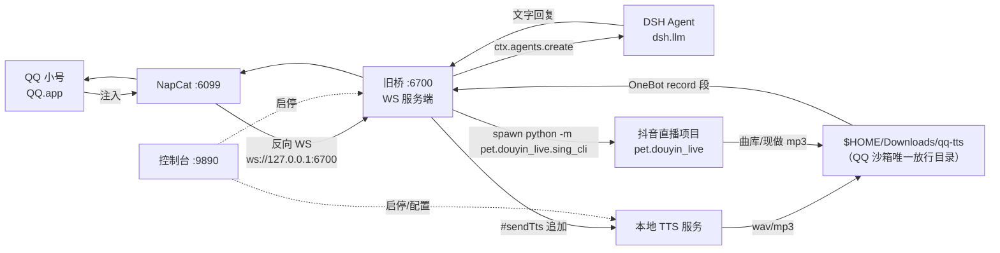

# 交接背景：懂你的QQ大肥鱼 · A / B / C 路线与全链路梳理

> 生成：2026-11-09 05:40（北京时间）　用途：**直接投喂给另一个模型**，让它不必重新翻十几轮对话和十几个文件就能接手。  
> 读完之后应该能回答：现在跑的是什么、A 和 C 分别是什么以及怎么做、用户新提的「轻量但要解耦 + 翻唱/TTS/发图」落在哪、哪些坑不能重踩。  
> 本文是**背景与方案说明，不是已批准的改动清单**。所有「现状」均来自本机实测或源码，所有「建议」均标明为建议。

---

## 0. 一页速读

| 项              | 结论                                                                                                                                                              |
| -------------- | --------------------------------------------------------------------------------------------------------------------------------------------------------------- |
| 现在在做的          | **B 路线**：`<本仓库>`，基于 `aureth-labs/`但本质上， v1.2.0（MIT，HEAD `a41519c`）二开，产品名「懂你的QQ大肥鱼」。**P0 已完成**（去品牌、断上游回连、自有素材、前端原型、测试无新增红），下一步原计划 P1 |
| 用户记混的关键        | **存在两套同名的 A / B / C**。一套是 11-07 调研报告里的「技术选型三条路线」，一套是 11-08 晚「项目必要性反思」里的「投入量级三条路线」。用户这次问的「A 和 C 是轻量级的」= **第二套**                                                  |
| 第二套定义          | **A 收** = 不建新项目，只修 3 个 bug + 一键脚本 + 软解耦（1~~2 天）；**B 放** = P0~~P6 全套开源产品；**C 验** = 只做 P1（service 包剥离）+ 最小向导，找 2~3 人真装一次再决定                                       |
| 用户最新倾向（尚未正式拍板） | 「不想做那么重，但想要解耦，又要把翻唱和 TTS 加进去，还有发图片」→ 精确对应 **C 的范围 + 三个能力必达**，本文称 **C′**；等价于「在 B 路线上按 C 收口：保留 P0，只做 P1，暂停 P2–P6」                                                 |
| 现状链路一句话        | QQ 小号 → NapCat（注入 QQ.app）→ **反向** WS 连桥 6700 → 桥 → DSH Agent → 文字 + 语音条；说话走本地 TTS 端口，翻唱由桥 spawn **抖音直播项目里的 Python 模块** `pet.douyin_live.sing_cli`               |
| 最痛的耦合          | QQ 能力寄生在 `dsh-pet-indesktop`（抖音直播项目）里：脚本、配置 `settings.json`、曲库 `music/`、进度 `sing-progress.jsonl`、9890 控制台全在里面                                                   |

---

## 1. 先把名词和仓库分清楚（最容易串）

| 名字     | 绝对路径                                                                                                                 | 是什么                                                      | 不是什么                                              |
| ------ | -------------------------------------------------------------------------------------------------------------------- | -------------------------------------------------------- | ------------------------------------------------- |
| 抖音直播项目 | `<旧项目>`                                                                            | 本会话的工作目录；含 Python 包 `pet.douyin_live`、9890 控制台、翻唱曲库与配置   | 不是 QQ 机器人产品                                       |
| 旧桥     | `~/.dsh/profiles/desktop/node_modules/dsh-qq-onebot-bridge`（v0.8.5）                                   | **通道层**适配器 + 消息消费者：DSH Agent 的回复搬进/搬出 QQ；自带 8799 调试台     | 不是「大脑」，名字里的 bridge 一直误导人；也不是 NapCat               |
| 新项目    | `<本仓库>`                                                                                  | **产品层**：Aurabot 完整副本（人格、记忆、心情、审批、定时任务、25 页面板、5 步向导、模块系统） | 上游只是代码来源与 merge 源头，**不是运行时依赖**                    |
| 运行副本   | `~/tools/gsv-run/`                                                                                                   | 真正被 `qq-stack.sh` 执行的脚本副本                                | 与仓库 `docs/qq-voice-kit/scripts/` 是两份，改错地方不生效（坑 2） |
| NapCat | `~/Library/Containers/com.tencent.qq/Data/Documents/napcat/`；安装器已移到 `<NapCat 安装器>` | **QQ 网关**：QQ → OneBot v11。注入进 QQ.app 同一进程                | 不是第二个 QQ、不是容器里的小号                                 |
| DSH    | DeepSeek Harness，用户已装                                                                                                | 宿主；提供 `dsh.llm`，两个插件共用同一个 LLM 底座                         | 不做安装引导                                            |

**三坐标（判断「这东西属于谁」）**：运行位置 / 注册作用域 / 逻辑归属。  
模型归 DSH；网关归通道；技能、记忆、面板、日志归肥鱼；**实现体（Python 音频/图像服务）绝不塞进 QQ 插件进程**。

---

## 2. 现状链路（2026-11-09 01:45 实测六个端口全绿）



### 2.1 端口与启动顺序（`qq-stack.sh start`，倒序停止）

| 端口   | 组件                          | 位置 / 说明                                                                                                    |
| ---- | --------------------------- | ---------------------------------------------------------------------------------------------------------- |
| 9881 | GPT-SoVITS `api_v2`         | `~/tools/GPT-SoVITS`，Python 3.10，暴露 `POST /tts`                                                            |
| 9882 | 响度代理 `gain_proxy.py`        | +8 dB / 限幅，转发到 9881；**放大削波是撕裂音的加重因素**                                                                      |
| 9883 | 语音服务 `voice_cli.py --serve` | `pet.douyin_live.voice_cli`，Python 3.12；`GET /healthz` + `POST /synth`（千问3-TTS MLX / Breeze 远程）；常驻后模型只加载一次 |
| 6099 | QQ + NapCat WebUI           | 注入靠 `loadNapCat.js` 读 `napcat.enabled` 标记 + `open -a QQ`                                                   |
| 6700 | 旧桥（DSH 插件进程内）               | WS **服务端**，等 NapCat 来连                                                                                     |
| 9890 | 本地控制台 `console.py`          | 启停、三引擎切换、试听、路径、搜歌验证、日志进度                                                                                   |
| 8799 | 旧桥自带调试台                     | 端口/进程、启停、trace、能力体检、录制回放、账号中心                                                                              |

|   |   |
| - | - |

> 说话引擎只加载一个：读 `~/.dsh/profiles/desktop/qq-voice.json` 的 `provider`。`gpt_sovits` → 9881/9882；`qwen_local | breeze` → 9883。`QQ_ENGINE=all` 才两套都起。

### 2.2 说话（TTS）链路

```
DSH Agent 回复文字
  → 桥 lib/bridge.js:6338  if (sent && ttsEnabled) void this.#sendTts(...)   ← 文字后固定再发一条语音
  → lib/bridge.js:2814-2816  max = ttsMaxChars(默认120), clean.slice(0,max) + '……'  ← 长文本只读前 120 字
  → lib/tts.js:35 synthesizeTts()
      local provider: POST {ttsLocalUrl}/tts   (默认 http://127.0.0.1:9880；本机实际配到 9881/9882 体系)
      body = buildLocalTtsRequest(config, text)  ← 整段文本一次性塞进去，无分句、无拼接
  → 音频写入 $HOME/Downloads/qq-tts/
  → OneBot record 段发回 QQ
```

**三个已知 bug（都在通道层，不碰大脑）**：

| # | 位置                        | 症状        | 根因                                                                |
| - | ------------------------- | --------- | ----------------------------------------------------------------- |
| 1 | `lib/bridge.js:6338`      | 文字 + 语音双发 | `ttsEnabled` 为真时无条件追加语音，是硬设计不是配置问题                                |
| 2 | `lib/bridge.js:2814-2816` | 长文本「只读一半」 | `ttsMaxChars: 120` + `slice(0,max)+'……'`，上游配置在 `cordis.patch.yml` |
| 3 | `lib/tts.js:53`           | 撕裂音、断句怪   | 整段文本一次 `POST /tts`，无分句合成 + 静音拼接；9882 的 +8 dB 再削波                  |

> 注意端点不同：桥的 `local` provider 打 `/tts`（GPT-SoVITS api_v2 口径），而 `voice_cli.py --serve` 暴露的是 `/synth`。接手时先读 `qq-voice.json` 与桥的 `ttsProvider` 确认当前实际走向，**不要假定 9883 就是桥连的那个**。

### 2.3 翻唱链路（用户说的「调用了抖音这边的服务」）

准确说法：**不是抖音的在线服务，也不是直播后台的 HTTP 接口，而是旧桥直接 spawn 抖音直播项目里的 Python 模块**。

```
模型调工具 qq_sing(title)                ← 桥 bridge.js:4472 用 ctx.agents.create 注册给 DSH Agent
  → 桥 #singTo()  execFile(python,
        ['-m','pet.douyin_live.sing_cli','--title',X,'--data-dir',<直播应用数据>/douyin-live],
        { cwd: <直播项目根目录>, timeout: 900000 })
  → 曲库优先：music/index.json + music/covers/ 命中 → 秒回
    未命中 → 搜歌 music.txqq.pro → 下载 → demucs htdemucs 分离（-d mps）
           → Applio/RVC 换声（~/tools/applio，.pth + .index，index_rate 0.5）
           → 混音（settings.json → cover.accompaniment_gain，默认 0.85；0 = 清唱）
           → 写 sing-progress.jsonl
  → 拷到 $HOME/Downloads/qq-tts/songs/   ← QQ.app 沙箱只放行 Downloads，不拷会 Operation not permitted
  → OneBot record 段发回；12 秒没做完先回「在做」，做完直接发，不阻塞模型
```

耦合点全在直播项目里：`console.py` 硬编码 `pet.douyin_live.{voice_cli,sing_cli,cover_source,cover_tools}`，读写 `~/Library/Application Support/douyin-virtual-live/douyin-live/settings.json` 与 `sing-progress.jsonl`；曲库几百 MB 也在那儿。**这就是「QQ 面板目前是直播项目的附属面板」的来源，也是 P1 要解掉的结。**

配置键（桥侧）：`singDataDir / singOutDir / singPython / singCwd / singWaitMs / singTimeoutMs`。

### 2.4 发图片链路（用户「我有个本地生成图片的技能」）

三条已存在的接缝，**能力本身不必从零做**：

1. **旧桥**：已有 `qq_send_image` / `qq_send_file` / `qq_send_voice` 工具（`README:14` 的 `ctx.agents.create`），发的是 OneBot `image` 段；同样受 Downloads 沙箱限制。
2. **新仓库 `dsh-qq-soul`**：`src/modules/imagegen/index.js` 已注册 `qq_draw_image` 工具 → `src/features/imagegen.js` 的 `createImageGen().generate()` → 结果统一成 Buffer → 发到聊天，画作存 `data/imagegen/`。  
   |  |  |  |  |  |  
   | --- | --- | --- | --- | --- |
3. **本地技能的标准接口**：`src/local/local.js:13-19` 定义了 `SLOTS = { tts, image, song, asr, video }`，其中 `image` 槽的示例就是 **ComfyUI :8188 / SD WebUI :7860**。放一个 `~/.dsh/plugins-data/aurabot/local/image.mjs`，按 mtime 热重载，`local.active('image')` 优先于内置；返回 `Buffer | {buffer|file|base64|url}` 都行（`toImageBuffer()` 统一）。

→ 用户自己的本地生图技能，**接 `image` 槽**（或 service 的 `/image/generate`）最省事，不要塞进 QQ 插件、更不要注册成 DSH 全局技能。

内置生图兜底：`features/imagegen.js` 支持 OpenAI 兼容 `/v1/images/generations`、custom 接口（URL 模板 + JSON 取值路径）、实验性 Codex 订阅。

---

## 3. 两套同名的 A / B / C（本次最容易搞错的地方）

### 3.1 第一套：11-07 调研报告里的「技术选型三条路线」

出处：`<旧项目>/docs/qq-voice-research.html:1097-1117`。

|   | 名称        | 内容                                                                 | 适合               |
| - | --------- | ------------------------------------------------------------------ | ---------------- |
| A | **最省**    | `dsh-qq-onebot-bridge` + GPT-SoVITS，唱歌继续现有 RVC                     | 主要想私聊/群里听她说话     |
| B | **最像大肥鱼** | `dsh-aurabot-qq` 管人格/记忆/语音，唱歌用现有 Mac RVC（上游 RVC 只支持 Windows，两边分开跑） | 要「她记得我、会接梗、会发表情」 |
| C | **最高音质**  | Breeze 云端说话 + Kits AI / ACE Studio 云端唱歌，付费订阅，数据离本机                 | 不想折腾本地模型         |

报告当时的「最终建议」是 **先走路线 A**（:1124），后来被明确认错三处：① 「语音首选 / 人格首选」两个 ribbon 把分场景首选呈现成了整体排名；② 「最省」只算当天配置步骤，没把「给朋友用 / 要面板 / 可维护」计入；③ 把「上游 Mac 唱歌要另走本地链路」当成走不通，高估了 B 的门槛（用户当时已有跑通的 Applio/demucs Mac 链路，3.2 分钟/首）。

> **这一套的 C 不是「轻量级」，是云端付费方案。** 用户说「A 和 C 是轻量级的」，指的绝不是这套。

### 3.2 第二套：11-08 23:45「我为什么要做这个项目」给出的「投入量级三条路线」

出处：`<旧项目>/.workbuddy/memory/2026-11-08.md` 第七轮；用户这次问的就是它。

|       | 名称              | 定义                                                        | 量级      |
| ----- | --------------- | --------------------------------------------------------- | ------- |
| **A** | **收**           | **不建新项目**；修三个 bug + 一键脚本 + 软解耦                            | 1~2 天   |
| **B** | **放**           | 按 `IMPLEMENTATION-PLAN.md` 的 **P0~P6** 做开源产品，接受本质是「产品化工程」 | 周级、长期维护 |
| **C** | **验**（当时 AI 推荐） | **只做 P1**（service 包剥离）+ 最小向导，找 2~3 人真装一次，验证需求后再决定要不要投入    | 最轻、可随时停 |

**用户 11-09 04:17 拍板走了 B**，A / C 当时被排除。现在用户重新觉得 B 太重，问起 A 和 C —— 这不是要回滚 P0，是想找一条「既解耦又不重」的中间路。

### 3.3 B 的 P0~P6 现状（对照用）

| 期  | 内容                                                                                                  | 状态                                                             |
| -- | --------------------------------------------------------------------------------------------------- | -------------------------------------------------------------- |
| P0 | 合规与仓库：去品牌、断上游回连、自有素材、去品牌回归测试、前端原型                                                                   | **已完成**（1222 tests / 1211 pass / 6 fail，6 个是上游既有红，失败清单与改前完全一致） |
| P1 | service 包骨架：抽 `voice_cli/sing_cli/cover_*/rvc*`，去掉 `pet.douyin_live` 与直播配置硬编码，单端口 9876 + supervisor | 下一步，未做                                                         |
| P2 | ModelRegistry：引擎互斥 / idle 8min / 音色 LRU=2 / 探针音                                                     | 未做                                                             |
| P3 | 翻唱策略 + 整体替换 song 模块：四档取窗、RMS 起唱点、trimStart、htdemucs                                                 | 未做                                                             |
| P4 | 面板：依赖体检、模型四态、翻唱策略、job 日志、驻留清单                                                                       | 原型已出，代码未做                                                      |
| P5 | 双平台安装器（mac/win provider）                                                                            | 未做                                                             |
| P6 | 网关方向修正（反向 → 正向 WS）+ 分发                                                                              | 未做                                                             |

### 3.4 「两者不都一样吗」——同构，但边界不同（11-09 06:24 追加）

> 接手模型最可能复问的一句：旧桥是「一个桥 + 几个工具 + 功能管理」，`dsh-qq-soul` 不也是？那凭什么说旧桥不合理？
> **答：结构确实同构。不合理的是边界，不是清单长度。**

**先校准一个小事实**：旧桥并不是「三个工具」的整齐三件套。
- **TTS 不是工具**，是 `bridge.js:6338` 的 `if (sent && ttsEnabled)` 出站副作用 —— 模型和用户都不能决定这一条发不发，这正是 bug 1 的根源；
- `qq_sing` 是工具（`skills/qq-sing` 补丁加的），实现体 `#singTo()` 焊在桥里；
- `qq_send_image` / `qq_send_file` / `qq_send_voice` / `qq_recall`（`agentMediaToolsEnabled`）、`qq_face_list` / `qq_face_send`（`faceEnabled`）都是**搬运工具**，生图能力并不在桥里。

| 判据 | 旧桥 `dsh-qq-onebot-bridge` | `dsh-qq-soul`（Aurabot 二改） |
|---|---|---|
| 连接层 | **独立插件进程**，WS 服务端 `:6700` | `src/onebot/client.js` **内置模块**（HTTP 调接口 + WS 收事件 + 断线重连），不是另一个桥插件 |
| 能力清单 | 1 个硬编码副作用 + 1 个补丁工具 + 一组媒体搬运工具 | **16 个内置模块**（`voice / song / imagegen / memory / mood / stickers / diary / speakup / purpose / bili / video / profile / contacts / qzoneSocial / qqTools / qqApi`），用 `api.tool()` 注册 |
| 会话状态 | **无**；回复由 DSH Agent 生成，桥只搬运 | `src/chat/hub.js` + `features/memory.js` + `personas/` + mood + 定时任务 / 主动搭话，身份与情绪跨消息连续 |
| 谁决定「做不做」 | 硬编码 `if` | `cfg.voice.enabled` + `wantVoice`（会话/用户意图）+ `autoChance * mood().voice` + 审批 / 权限 / `ownerOnly` |
| 实现体住哪 | **同进程焊死**；翻唱还 spawn 另一个仓库的 `pet.douyin_live.sing_cli` | `src/local/local.js` 的 `SLOTS = tts / image / song / asr / video` 是**现成接缝**；`voice / imagegen / song / video` 都在调 `local.active()` + `local.call()`，脚本优先于内置；`song` 模块导出 `request/search/status/install` 可整体替换 |
| 注册作用域 | `ctx.agents.create` 建 DSH Agent 会话 | `agent.ctx.tools.register`，**只挂肥鱼自己的会话** |

**「不合理」的准确含义（拆成两句，都跟工具数量无关）**：

1. **产品层**：把「通道适配器」当成了产品主体，但用户要的是「住在 QQ 里的角色」。能力以补丁 / 出站副作用的形式挂着，没有人格、记忆、心情、状态与可观测 —— 靠「桥 + 提示词」补不出来，因为决策主体在 DSH Agent 而不在插件。
2. **工程层**：能力实现体与通道同仓同进程，还跨到抖音直播项目读配置 / 曲库 / 进度 → 不可分发、不可维护。「解耦」要斩的是这个**耦合位置**。

反过来，新插件的「解耦」不是要改造出来的工程，而是**上游既有设计**：SLOTS 接缝 + 可整体替换的模块。B 的 P1 只是把这个接缝从「本地 `.mjs` 脚本」升级成「独立 service 进程（9876）」。

**诚实结论（呼应 11-08 第七轮）**：单看「连 QQ + 说话/翻唱/发图」三个能力，两者 **0 差别**。B 真正买到的是旧桥没有的三件东西：① 角色运行时；② 可替换的能力接缝；③ 产品外壳（5 步向导 / 25 页面板 / 模块 / 日志 / 权限，让朋友装机不用 1 小时）。**若只要 ② + 三个能力，①和③就是溢价 —— 这正是 §6 的 C′。**

**不能同时装**：`id: aurabot` / `dataDir()` / preset ID 三者相同会撞配置与记忆目录；同一 QQ 号两个消费者还会抢答双份回复。这恰好说明两者占的是**同一个生态位**，不是可以叠加的两层。

---

## 4. A 怎么做（完整可执行版）

**目标**：不建新项目、不动产品层，把「自己用」的体验修好，并把耦合**减轻**（不是消除）。

### 4.1 修桥的 3 个 bug

| 步骤 | 文件                        | 改法                                                                                                                                              |
| -- | ------------------------- | ----------------------------------------------------------------------------------------------------------------------------------------------- |
| 1  | `lib/bridge.js:6338`      | 加 `ttsSendPolicy: 'voice-only' \| 'both' \| 'by-length'`，默认 `voice-only` 或按长度；`if (sent && ttsEnabled)` 改为按策略判断，别再无条件 `void this.#sendTts(...)` |
| 2  | `lib/bridge.js:2814-2816` | 删掉 `clean.slice(0,max) + '……'` 的**朗读截断**；`ttsMaxChars` 只保留作「要不要转语音」的决策门槛，不再切正文                                                                  |
| 3  | `lib/tts.js` + 本地 TTS 服务  | 长文本按标点分句（建议 `maxChars: 80`）→ 逐句 `POST /tts` → 段间插 220ms 静音拼接成一条音频；同时把 9882 的 +8dB 调小或加真限幅，消除削波                                                  |

**执行注意（血泪）**：

- 改的是 `~/.dsh/profiles/desktop/node_modules/dsh-qq-onebot-bridge/lib/`，**必须完整退出并重开 DSH**；只保存配置会重启插件实例但不重新 import 模块（日志会写 `changed modules keep running their previous code until a restart`）。
- 还有 `docs/qq-voice-kit/scripts/` 与 `~/tools/gsv-run/` **两份脚本**。改完用 `diff` 对齐，否则复现「坑 2：改了代码不生效」。
- 补丁参考模板：`docs/qq-voice-kit/skills/qq-sing/references/patch.md`（含注册工具、配置 schema、验证步骤）。

### 4.2 一键脚本与 NapCat 固化

|   |   |   |   |   |
| - | - | - | - | - |

- `scripts/qq-stack.sh start|stop|status|restart|restart-bridge` 已有，日常够用。
- **待补**：`fix-napcat-loader.sh`，把容器里 `loadNapCat.js` 的判定行固化为  
  |  |  |  |  
  | --- | --- | --- |  
  `process.argv.includes('--no-sandbox') || fs.existsSync(path.join(__dirname,'napcat.enabled'))`。  
  原因：QQ 更新或重跑 `NapCatInstaller.app` 会把加载器覆盖回只认 `--no-sandbox` 的原版，导致 6099 永不监听、桥一直干等（11-09 00:24 真实发生过，用户已手工修好，但脚本仍未固化）。README 说「按 qq-stack.sh 顶部说明重新应用」，但顶部并没有给具体改法，是文档漏洞。

### 4.3 软解耦（不抽 service 的前提下）

- 把 `sing_cli` 的 `python -m pet.douyin_live.sing_cli` 与 `cwd` 外置成配置项（已有 `singPython` / `singCwd`，补齐文档与校验）。
- 把 `settings.json → cover` 与 `sing-progress.jsonl`、`music/` 路径从 `console.py` 硬编码改成读 `qq-voice.json` 的新字段。
- **仍然依赖直播项目**，只是不再写死；这是 A 与 C 的根本差别。

### 4.4 加发图片

把本地生图技能包成一个最小 HTTP（例如 `POST /generate {prompt} → 图片文件路径或 base64`），在桥里注册一个工具（或复用 `qq_send_image`），生成后落 `$HOME/Downloads/qq-tts/`，再发 OneBot `image` 段。


### 4.5 A 的验收与代价

验收：私聊一句 → 只有一条语音不重复；长文本完整不撕裂；点歌唱一首能发；「画一只鱼」能收到图；`qq-stack.sh status` 全绿。
**仍然存在的代价**：六个端口手启、NapCat 手装、无面板/记忆/人格、朋友装机 1 小时+、代码仍寄生直播项目、网关仍是反向 WS。

---

## 5. C 怎么做（完整可执行版）

**目标**：不造产品层，只验证「换基座 + 解耦」这两件事是否成立，验证完再决定要不要继续砸 B 的 P2–P6。

### 5.1 网关迁移（唯一无法靠配置绕过的硬改动）

1. 卸载 / 禁用旧桥 `dsh-qq-onebot-bridge`。
2. 改 NapCat 配置 `~/Library/Containers/com.tencent.qq/Data/Library/Application Support/QQ/NapCat/config/onebot11_<QQ号>.json`：
   - `network.websocketServers` 从 `[]` 改成 `[{ "enable": true, "port": 3001, ... }]`（正向 WS 服务端）；
   - **必须关掉** `network.websocketClients` 里 `{name:"dsh-bridge", url:"ws://127.0.0.1:6700"}` 这一条，否则同一个 QQ 号被两个消费者订阅 → **抢答 / 双份回复**，不是扩容。
3. `dsh-qq-soul` 的 `src/core/config.js:27-29` 明确：`gateway:'onebot'` 时插件「只按 wsUrl 去连，不启动、不注入任何东西」；`src/onebot/client.js:156` 是 `new WebSocket(url)`，token 走 `access_token` query。
4. 只装**一个**插件：`dsh plugin --profile desktop add <本仓库>`（本地目录安装，避免坑 2）。**绝对不能同时装上游** `dsh-aurabot-qq`：挂载 `id: aurabot`、`dataDir()` `~/.dsh/plugins-data/aurabot/`、preset ID 三者相同，会撞配置/记忆目录/QQ 消息流。

### 5.2 只做 B 的 P1（service 包剥离）

把 `voice_cli.py` / `sing_cli.py` / `cover_*` / `rvc*` 从 `pet.douyin_live` 抽到 `dsh-qq-soul/services/`，起一个**单端口**服务 `127.0.0.1:9876`（token 鉴权），内部 supervisor 托管子进程与启动顺序，取代 9881→9882→9883→6099→6700 的手工顺序。

最小端点（先别做 P2/P3 的全套契约）：

```
GET  /healthz
GET  /status                  → { engines, jobs[] }
POST /tts/speak               → { text, engine, voice } → { file, durationMs }   # 内部分句 + 静音拼接
POST /song/request            → { title, strategy }     → { jobId }              # 曲库优先
GET  /song/jobs/{id}          → 分阶段进度（下载/分离/换声/混音/发送）
POST /image/generate          → { prompt, ref? }        → { file } 或 base64
```

三个模块只保留薄 HTTP 客户端：
- `src/modules/voice` 保持 `speak(text) → {file, engine}`；
- `src/modules/song` **整体替换**（保持导出 `request / search / status / install` 不变），不要给 `studio.js` 的 `separate()` 补接缝 —— 那样会被 `C:\Aurabot\rvc`、`env/Scripts/`、CUDA torch、`status()` 四项检查继续绑死；
- `src/modules/imagegen` 接 `local/image.mjs` 或 `POST /image/generate`。

### 5.3 最小向导 / 体检

只做三项：端口在不在、模型路径在不在、能否读一句 / 唱一首 / 出一张图。**不做** P4 运维大屏、不做 Token 统计 / 时间线 / 模型池 / 双平台安装器。

### 5.4 验证需求

找 2~3 个没装过的人真装一次，记录耗时与卡点，再决定要不要继续 B 的 P2–P6。

### 5.5 C 的验收

- **不启动抖音直播后台**，也能读一句、唱一首、发一张图；
- `grep -r "douyin_live" services/` 无命中；
- 上游插件没装、只连正向 WS、无双份回复；
- `npm test` 不新增红（基线 1222 tests / 1211 pass / **6 fail**，6 个是上游既有红）。

---

## 6. 用户最新倾向 → 建议 C′（本文的核心建议，待用户拍板）

用户原话要点：「目前在做 B，A 和 C 忘了，反正是轻量级的；**不想做那么重，但想要解耦开来，又把翻唱和 TTS 的功能加进去，还有发图片**」。

拆解：

| 要什么 | 对应哪条路线 |
|---|---|
| 不要重 → 不要 P2~P6（模型池、双平台安装器、运维大屏、Token、7 天时间线） | C |
| 要解耦 → 必须做 P1（service 包剥离、单端口、摆脱直播项目） | C / B 的 P1 |
| 要翻唱 + TTS + 发图 → 三个能力都要接进新基座，且必须能真跑 | A 和 C 都没完整覆盖**发图**；A 也不换基座 |

**建议 C′ = C 的范围 + 三能力必达 + 保留 P0**：

1. **不回滚 P0**（去品牌、断回连、素材、原型、测试），它已经完成且无新增红。
2. **只做 P1**：service 解耦到 9876，三个能力各走一个端点，三个模块做薄客户端。
3. **暂停 P2–P6**：文档 `IMPLEMENTATION-PLAN.md` 与 `DECISIONS.md` 原样保留，随时可续；不要删。
4. **网关方向**：C′ 仍需要 P6 里的那一步（NapCat 开正向 WS + 关 6700 client），这是**硬前置**，不能省；但不需要 P6 的分发/发布部分。
5. 与 B 的关系：**不是换路线，是在 B 路线上按 C 的范围收口**。若哪天想做完整产品，直接从 P2 接着走。

**明确不做（C′ 范围外）**：ModelRegistry / 引擎互斥 / idle 卸载 / 音色 LRU=2 / 四档取窗 / RMS 起唱点 / `.index` 策略 / 双平台安装器 / 模型四态页 / 运维大屏 / 每日 Token / 统一时间线 / Markdown Skill 加载器 / 7 天正文留存。

---

## 7. 三个能力的接入契约（给接手模型直接落地用）

| 能力 | 模型侧工具 | 新基座位置 | service 端点 | 产物 → QQ |
|---|---|---|---|---|
| 说话 | `voice.speak(text)`（现有） | `src/modules/voice` 薄客户端 | `POST /tts/speak` | wav/mp3 落 `~/Downloads/qq-tts/` → OneBot `record` 段 |
| 翻唱 | `qq_song_cover` / `song.request(title)`（保持导出不变） | `src/modules/song` **整体替换** | `POST /song/request` + `GET /song/jobs/{id}` | 成品 mp3 落 `~/Downloads/qq-tts/songs/` → `record` 段 |
| 发图 | `qq_draw_image`（上游已注册） | `src/modules/imagegen` 或 `local/image.mjs` | `POST /image/generate`（或本地脚本直出） | Buffer / 文件 → OneBot `image` 段 |

**统一约束**：
- service 只听 `127.0.0.1`、带 token，不暴露公网；
- 所有对外产物必须落 **`$HOME/Downloads/`**（QQ.app 沙箱只放行这里，Windows 无此限制但保持一致更省事）；
- 长任务（翻唱、生图）**先回「在做」，完成后主动发**，不要让 LLM 轮询或等 —— LLM 只管意图，执行与重试归 service，状态归确定性通道；
- 错误用可枚举 code + 一句可行动人话，模型只转述不诊断，省 token 也少幻觉；
- 模型归 DSH（`dsh.llm`），能力注册作用域**只挂肥鱼自己的会话**，不做 DSH 全局技能。

---

## 8. 已知坑清单（接手前必读，别重踩）

| # | 坑 | 后果 / 规避 |
|---|---|---|
| 1 | 双副本：`docs/qq-voice-kit/scripts/` vs `~/tools/gsv-run/` | 改了不生效；改完 `diff` 对齐。安装也必须用本地目录 `dsh plugin add <本地路径>` |
| 2 | NapCat 加载器被覆盖 | QQ 更新 / 重跑 `NapCatInstaller.app` 会把 `loadNapCat.js` 还原成只认 `--no-sandbox` → 6099 不监听 → 桥干等。需固化修复脚本 |
| 3 | 网关方向反了 | 现状 NapCat **反向** WS 连桥 6700；新基座要插件连 **正向** WS。不是换个地址就行 |
| 4 | 同一 QQ 号多消费者 | OneBot 每条连接一份全量消息，无 consumer group → **抢答 / 双份回复**，不是扩容。迁移时必须关掉旧的 `websocketClients` |
| 5 | QQ.app 沙箱 | 只放行 `$HOME/Downloads`，音频/图片不拷过去会 `Operation not permitted` |
| 6 | 改桥不重开 DSH | 保存配置只重启插件实例，模块代码不重新 import；必须完整退出重开 |
| 7 | 切 TTS 引擎旧模型不释放 | 上游 `src/voice/tts.js` 只换路由，GSV 进程仍驻留、新引擎再起一份；无卸载机制（B 的 P2 才解决） |
| 8 | 同时装上游插件 | 挂载 ID / 数据目录 / preset ID 三处撞车，双份回复 |
| 9 | 长文本整段送 TTS | 撕裂音；9882 的 +8 dB 加重削波。分句 + 静音拼接是必需项 |
| 10 | `dataDir()` 不分 profile | `~/.dsh/plugins-data/aurabot/` 全局共享，两个 profile 同装会串数据；开发期用 `AURABOT_DATA_DIR` 隔离 |
| 11 | 两个 ribbon 误导 | 「语音首选 / 人格首选」是分场景标签，不是整体排名；别再据此推荐 A |
| 12 | 测试基线 6 红 | 图片归档 5 个 + `workspace-move.test.js` 1 个，是上游既有失败，**不是新改动引入**；别去「修」它们 |

---

## 9. 文件索引（绝对路径，接手模型直接读）

| 用途 | 路径 |
|---|---|
| **本交接文档** | `<本仓库>/docs/HANDOFF-BACKGROUND.md` |
| 决策单一事实源（25 条决策、合规边界、测试基线） | `<本仓库>/docs/DECISIONS.md` |
| P0~P6 实施方案 / service HTTP 契约 / 目录结构 | `<本仓库>/docs/IMPLEMENTATION-PLAN.md` |
| 面板设计输入（技能形态、记忆、面板四块、视觉风格） | `<本仓库>/docs/PANEL-DESIGN-INPUT.md` |
| 可双击打开的前端原型（59 KB 单文件） | `<本仓库>/docs/prototype/index.html` |
| 11-07 调研报告（含**第一套** A/B/C、8 个坑、成本表） | `<旧项目>/docs/qq-voice-research.html` |
| 可分发的语音技能包说明（端口、控制台、唱歌开关） | `<旧项目>/docs/qq-voice-kit/README.md` |
| 桥补丁模板（`qq_sing` 完整插入点与代码） | `<旧项目>/docs/qq-voice-kit/skills/qq-sing/references/patch.md` |
| 一键启停脚本（端口与启动顺序的权威来源） | `<旧项目>/docs/qq-voice-kit/scripts/qq-stack.sh` |
| 三引擎说话服务（`/synth` 契约） | `<旧项目>/docs/qq-voice-kit/scripts/voice_cli.py` |
| 旧桥 TTS 实现（三个 bug 之一） | `~/.dsh/profiles/desktop/node_modules/dsh-qq-onebot-bridge/lib/tts.js` |
| 本地接口槽定义（image / song / tts / asr / video） | `<本仓库>/src/local/local.js` |
| 生图实现（OpenAI 兼容 / custom / Codex / local 优先） | `<本仓库>/src/features/imagegen.js` |
| 翻唱现状（Windows-only 硬编码，整体替换对象） | `<本仓库>/src/song/studio.js` |
| NapCat 实锤配置 | `~/Library/Containers/com.tencent.qq/Data/Library/Application Support/QQ/NapCat/config/onebot11_<QQ号>.json` |
| 对话与调研全记录（**第二套** A/B/C 出处在 11-08 第七轮） | `<旧项目>/.workbuddy/memory/2026-11-08.md`、`2026-11-09.md` |

---

## 10. 给接手模型的任务卡（可直接复制）

```
背景：见 docs/HANDOFF-BACKGROUND.md（先完整读一遍，不要重新调研历史）。
项目：<本仓库>（产品名「懂你的QQ大肥鱼」），
      基座 aureth-labs/dsh-aurabot-qq v1.2.0 / MIT，P0 已完成。

用户诉求：觉得 B（P0~P6 全套）太重；要轻量、要解耦，
          要把「翻唱 + TTS + 发图片」三个能力接进去。
          本人尚未正式改路线，先按「C′ = 保留 P0 + 只做 P1 + 三能力必达」出方案，
          不要擅自开始 P2~P6。

必须做：
  1. 说清 A / C 各自怎么做（对照本文 §4 §5），并给出推荐与取舍。
  2. service 包单端口 9876，摆脱 pet.douyin_live、直播 settings.json、sing-progress.jsonl。
  3. 三能力各一条端点 + 三个薄客户端；发图接 local/image.mjs 或 /image/generate。
  4. 网关正向 WS 迁移步骤写全（含关掉 6700 client，防抢答）。
  5. 给出可执行的验收命令与「不启动直播后台也能跑」的验证方法。

不要做：
  - 不要回滚 P0；不要改 LICENSE / THIRD-PARTY-NOTICES.md；内部 ID 保持兼容。
  - 不要做 ModelRegistry / 双平台安装器 / 运维大屏 / Token 统计 / Markdown Skill。
  - 不要重跑 npm test 去「修」那 6 个既有红（属上游基线）。
  - 不要把实现体塞进 QQ 插件进程，不要注册成 DSH 全局技能。

先读：DECISIONS.md → IMPLEMENTATION-PLAN.md §2–§5 → 本文 §2 §8。
```

---

## 11. 状态与未决（诚实标注）

| 项 | 状态 |
|---|---|
| 路线 | 用户 11-09 04:17 拍板 **B**；11-09 05:40 后**口头表达轻量倾向**，**尚未正式改路线**。本文的 C′ 是建议，不是决定 |
| 代码进度 | P0 已完成；P1 起未动。前端原型已于 P0 提前交付 |
| 待确认（不阻塞） | ① 「Windows 上是 4.6」口述含义（疑为版本号，未写死）；② 是否新增 Markdown Skill 加载器（建议 P2 后）；③ `dsh.llm` 是否返回 `usage`；④ `origin` 地址（先本地开发）；⑤ FastAPI vs 标准库 http.server |
| 用户资产（别当新工作重做） | Mac 翻唱链路已跑通：`~/tools/applio`（含 torch/demucs 的 `.venv`）、`~/tools/models`（RVC `.pth` + `.index`）、`~/tools/GPT-SoVITS` 7.7G、`~/tools/qwen-tts` 488M；实测约 3.2 分钟/首。**安装包不带大模型**是已定决策 |
| 合规底线 | MIT：`LICENSE` / `THIRD-PARTY-NOTICES.md` / 源码许可头原样保留，`NOTICE.md` 已新增；用户可见品牌已换，内部 ID（`id: aurabot`、`/aurabot/api`、`ab-*`、preset ID、`dataDir()`）故意保留 |
